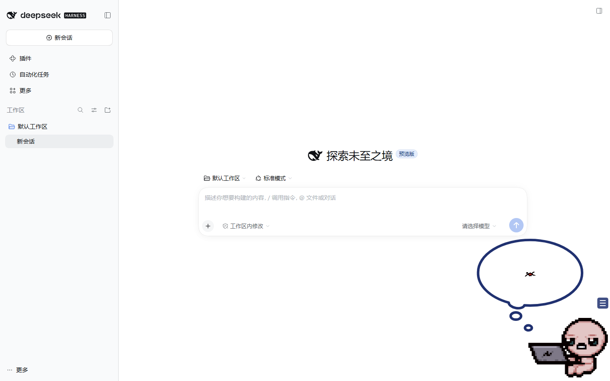

# dsh-isaac-widget

> 以撒住进 DeepSeek Harness 的右下角。透明像素动图、点击随机 `HurtGrunt`（点多了变 Isaac Dies 呃啊）、抬头冒出一只蜘蛛的思考泡泡。
>
> 复刻自小红书：<https://xhslink.cn/o/6dsgqEKAm62>



**Release 下载**：[`dsh-isaac-widget-0.1.1.zip`](https://github.com/komeiji-cobalt/dsh-isaac-widget/releases/download/v0.1.1/dsh-isaac-widget-0.1.1.zip) · [全部 Releases](https://github.com/komeiji-cobalt/dsh-isaac-widget/releases)

## 它是什么

一个 **DSH Web / 桌面端通用的右下角挂件**，基于 [`dsh-whale-widget`](https://github.com/MeteorNOX/DeepSeek-Balance-Whale-Widget) 魔改：

- **主形象**：512×400 透明 Isaac GIF，抱着笔记本
- **点击音**：前 5 次从 `HurtGrunt` 1/2/原版里随机；第 6 次起按递增概率随机播放 `Isaac Dies New` 1/2/3，播完一条死亡音后计数归零
- **点击泡泡**：白色思考泡泡 + 一只红色蜘蛛（4 帧小动画）
- **位置**：右下角，默认留 12px / 8px 边距
- **可改**：角色图、按压音效、泡泡内容、大小、吸附、余额显示等
- 原插件的余额 / 记账能力保留，但默认关闭了每轮消耗提示，避免打扰

### 随机点击音

- 第 1–5 次点击：只从 `HurtGrunt`、`HurtGrunt 1`、`HurtGrunt 2` 中随机
- 第 6 次起：每次点击按 `18% / 36% / 54% / 72% / 80%` 递增概率抽一条 `Isaac Dies New`（3 条随机）
- 播到 `Isaac Dies New` 后计数归零，回到 HurtGrunt，避免一直“呃啊”
- 切到别的音效组（如小黄鸭）时，恢复原插件的普通按压音逻辑

## 一键安装（给 Agent 的指令）

把下面这段直接发给任意能执行命令的 coding agent：

```text
请帮我安装 DSH 插件 dsh-isaac-widget（https://github.com/komeiji-cobalt/dsh-isaac-widget）。

步骤：
1. 如果当前 DSH 会话有 plugin_manager 工具：
   直接安装 github:komeiji-cobalt/dsh-isaac-widget 到当前 desktop profile。
2. 否则克隆仓库，在仓库根目录执行：
   powershell -NoProfile -ExecutionPolicy Bypass -File .\install.ps1 -Profile desktop
3. 不要强制结束正在运行的 DSH；安装完成后告诉我“需要完全退出 DSH（含托盘）再重开”。
4. 重开后确认：右下角出现以撒；点击后出现蜘蛛思考泡泡，并随机播放 HurtGrunt；多点几下会随机变成 Isaac Dies 的“呃啊”。
```

Windows 上也可以直接跑远程脚本：

```powershell
powershell -NoProfile -ExecutionPolicy Bypass -Command "& ([scriptblock]::Create((irm 'https://raw.githubusercontent.com/komeiji-cobalt/dsh-isaac-widget/main/install.ps1'))) -Profile desktop"
```

macOS / Linux：

```bash
git clone https://github.com/komeiji-cobalt/dsh-isaac-widget.git
cd dsh-isaac-widget
./install.sh            # 默认 desktop；可用 DSH_PROFILE=web ./install.sh
```

## 手动安装

### 桌面端（官方 Electron 客户端）

DSH 桌面端读的是 `desktop` profile。用安装包自带的 CLI：

```powershell
& "$env:LOCALAPPDATA\Programs\DeepSeek Harness\resources\runtime\cli\bin\dsh.cmd" `
  plugin --profile desktop add github:komeiji-cobalt/dsh-isaac-widget
```

或直接运行仓库里的 `install.ps1`。安装后 **完全退出 DSH（托盘右键退出）再重开**。

### Web 端（`dsh web`）

```bash
dsh plugin --profile web add github:komeiji-cobalt/dsh-isaac-widget
```

重启 `dsh web`，浏览器 `Ctrl+F5`。

> 首次启动时插件会把 `defaults/` 里的 Isaac、HurtGrunt、蜘蛛泡泡合并进 `$DSH_HOME`（默认 `~/.dsh`）。已有用户配置不会被覆盖。

## 安装后怎么玩

鼠标移到以撒身上，右上角出现 `☰` 菜单：

| 菜单 | 作用 |
|---|---|
| **角色** | 切换/导入角色图；当前角色是「以撒」 |
| **大小** | 整体缩放 |
| **音效与提示 → 全局设置** | 按压音效组、音量、任务结束音等 |
| **按压泡泡设置** | 编辑点击泡泡：文字、余额、图片、随机图片等 |
| **资源管理** | 查看/删除角色图、泡泡图、音频片段 |
| **吸附与翻转** | 四边吸附、贴边距离 |

点击以撒：播放 `HurtGrunt`，并弹出蜘蛛泡泡。再点一下收起。

## 资源来源

| 用途 | 来源 | 说明 |
|---|---|---|
| 主形象 | [Pinterest / GIPHY：Angry The Binding Of Isaac Sticker](https://www.pinterest.com/pin/676665912796172781/) | 512×400 透明 GIF，本地文件 `defaults/whale-roles/isaac.gif` |
| 点击音效 | [The Binding of Isaac: Rebirth Wiki — File:Hurt grunt.wav](https://bindingofisaacrebirth.wiki.gg/wiki/File:Hurt_grunt.wav) | `hurt_grunt.wav` + 用户提供的 `Hurt_grunt_1/2.wav`，共 3 条随机 |
| 死亡音效 | 用户提供的 `Isaac_dies_new.wav` / `_1` / `_2`（以撒 Wiki 角色音效） | 第 6 次点击起按概率随机；本地文件 `defaults/whale-audio/isaac_dies_new*.wav` |
| 蜘蛛帧 | [HHHFFei/IsaacAnimation2Gif](https://github.com/HHHFFei/IsaacAnimation2Gif) 的 `gfx/monsters/classic/monster_080_spider.png` | 重新上色并做成 4 帧 GIF，本地文件 `defaults/whale-bubble-imgs/bimg_isaac_spider.gif` |
| 基础插件 | [MeteorNOX/DeepSeek-Balance-Whale-Widget](https://github.com/MeteorNOX/DeepSeek-Balance-Whale-Widget) | 代码 MIT；本仓库在其 0.4.2 基础上改角色、音效、泡泡与默认值 |
| 原始灵感 | [小红书](https://xhslink.cn/o/6dsgqEKAm62) | 复刻目标 |

## 许可与声明

- **代码**：MIT，见 [LICENSE](LICENSE)。原插件版权归 MeteorNOX；本仓库的修改部分归 komeiji-cobalt。
- **以撒相关素材**（角色图、音效、蜘蛛帧）版权归 Edmund McMillen / Nicalis 及原素材作者所有，这里仅用于**个人、非商业的粉丝二创**，不随 MIT 授权再许可。
- 本项目与 DeepSeek、Nicalis、Edmund McMillen 均无隶属关系。
- 如果你是权利人并希望移除某份素材，请开 issue，我会尽快删除。

## 目录结构

```text
.
├─ assets/                 # 基础挂件前端 bundle + 少量兜底素材
├─ defaults/               # 首次安装自动写入 $DSH_HOME 的 Isaac 素材
│  ├─ whale-roles/         # isaac.gif + roles.json
│  ├─ whale-audio/         # HurtGrunt ×3 + Isaac Dies ×3 + audio.json
│  ├─ whale-bubble-imgs/   # bimg_isaac_spider.gif + bubble-imgs.json
│  ├─ .dshw-size.json      # 默认大小/音效组
│  └─ .dshw-bubble.json    # 默认蜘蛛泡泡
├─ lib/                    # 宿主半侧（含 defaults 首次写入逻辑）
├─ docs/preview.png        # README 预览图
├─ icon.png
├─ cordis.patch.yml
├─ install.ps1
├─ install.sh
└─ package.json
```

## 开发 / 本地安装

```powershell
dsh plugin --profile desktop add "link:$PWD"
```

修改 `assets/whale-widget.js` 后刷新页面即可（客户端半侧）；修改 `lib/index.js` 需要重开 DSH（宿主半侧）。

## 常见问题

**装完右下角什么都没有？**
桌面端必须**完全退出** DSH（包括托盘）再启动；只刷新页面不够。

**有以撒但没有声音？**
点一下以撒让浏览器解锁音频；再检查 `☰ → 音效与提示 → 全局设置 → 按压音效` 是否选中「以撒·受伤」。

**想换回小鲸鱼？**
`☰ → 角色 → 小鲸鱼`；或删掉 `~/.dsh/whale-roles/roles.json` 里的 `isaac` 条目。

**会不会很吵？**
默认只在点击时响 `HurtGrunt`，每轮消耗提示已关闭。若听到连续声音，检查是否有别的页面/实例在反复点击挂件。
